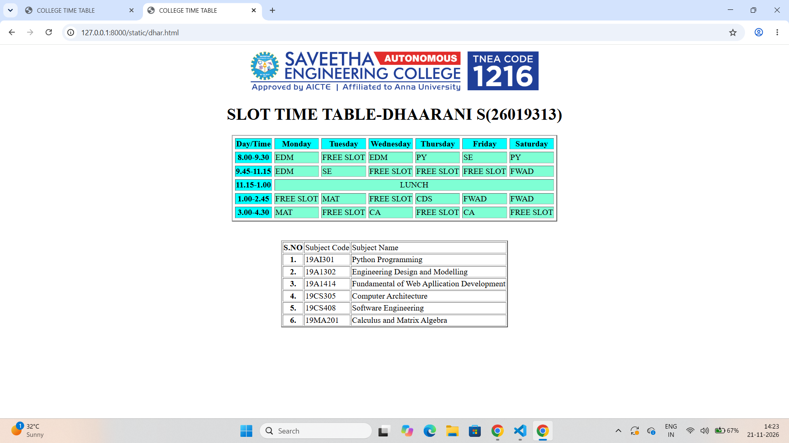

# Ex04 Time Table
## Date:21-11-2026

## AIM
To write a html webpage page to display your slot timetable.

## ALGORITHM
### STEP 1
Create a Django-admin Interface.

### STEP 2
Create an App inside the Django project.

### STEP 2
Create a static folder uder the created App and insert HTML code.

### STEP 3
Create a simple table using ```<table>``` tag in html with the relevant attributes.

### STEP 4
Add rows using ```<tr>``` tag.

### STEP 5
Add your course schedule using ```<td>``` tag.

### STEP 6
Execute the program using runserver command.

## PROGRAM
```
dhar.html
<html>
    <head >
        <title>COLLEGE TIME TABLE</title>
    <head>
    <body>
        <center>
            
            <h1>SLOT TIME TABLE-DHAARANI S(26019313)</h1>
            <table border="2" cellspacing="5" cellpading="6">
              <tr bgcolor="cyan">
                     <th>Day/Time</th>           
                     <th>Monday</th>
                     <th>Tuesday</th>
                     <th>Wednesday</th>
                     <th>Thursday</th>
                     <th>Friday</th>
                     <th>Saturday</th>
            </tr>
            <tr bgcolor="aquamarine">
                    <th bgcolor="cyan">8.00-9.30</th>
                    <td>EDM</td>
                    <td>FREE SLOT</td>
                    <td>EDM</td>
                    <td>PY</td>
                    <td>SE</td>
                    <td>PY</td>
            </tr>
            <tr bgcolor="aquamarine">
                    <th bgcolor="cyan" >9.45-11.15</th>
                    <td>EDM</td>
                    <td>SE</td>
                    <td>FREE SLOT</td>
                    <td>FREE SLOT</td>
                    <td>FREE SLOT</td>
                    <td>FWAD</td>
            </tr>
            <tr bgcolor="aquamarine">
                    <th bgcolor="cyan">11.15-1.00</th>
                     <td colspan="7" align="center">LUNCH</td>
            </tr>
            <tr bgcolor="aquamarine">
                    <th bgcolor="cyan">1.00-2.45</th>
                    <td>FREE SLOT</td>
                    <td>MAT</td>
                    <td>FREE SLOT</td>
                    <td>CDS</td>
                    <td>FWAD</td>
                    <td>FWAD</td>
            </tr >
        
            <tr bgcolor="aquamarine">
                    <th bgcolor="cyan">3.00-4.30</th>
                    <td>MAT</td>
                    <td>FREE SLOT</td>
                    <td>CA</td>
                    <td>FREE SLOT</td>
                    <td>CA</td>
                    <td>FREE SLOT</td>
            </tr>
            </table>
                 <br></br>
                <table align="centre" border="2" cellsapcing="5" cellpading="6">
                     <tr>
                       <th>S.NO</th>
                       <td>Subject Code</t>
                       <td>Subject Name</td>
                    </tr>
                    <tr>
                       <th>1.</th>
                       <td>19AI301</td>
                       <td>Python Programming</td>
                    </tr>
                    <tr>
                       <th>2.</th>
                       <td>19A1302</td>
                       <td>Engineering Design and Modelling</td>
                   </tr>
                   <tr>
                       <th>3.</th>
                       <td>19A1414</td>
                       <td>Fundamental of Web Apllication Development</td>
                   </tr>
                   <tr>
                       <th>4.</th>
                       <td>19CS305</td>
                       <td>Computer Architecture</td>
                   </tr>
                   <tr> 
                       <th>5.</th>
                       <td>19CS408</td>
                       <td>Software Engineering</td>
                   </tr>
                   <tr>
                       <th>6.</th>
                       <td>19MA201</td>
                       <td>Calculus and Matrix Algebra</td>
                   </tr>
            
                </table>
         </center>
    </body>
</html>

```


## OUTPUT
webpage


## RESULT
The program for creating slot timetable using basic HTML tags is executed successfully.
